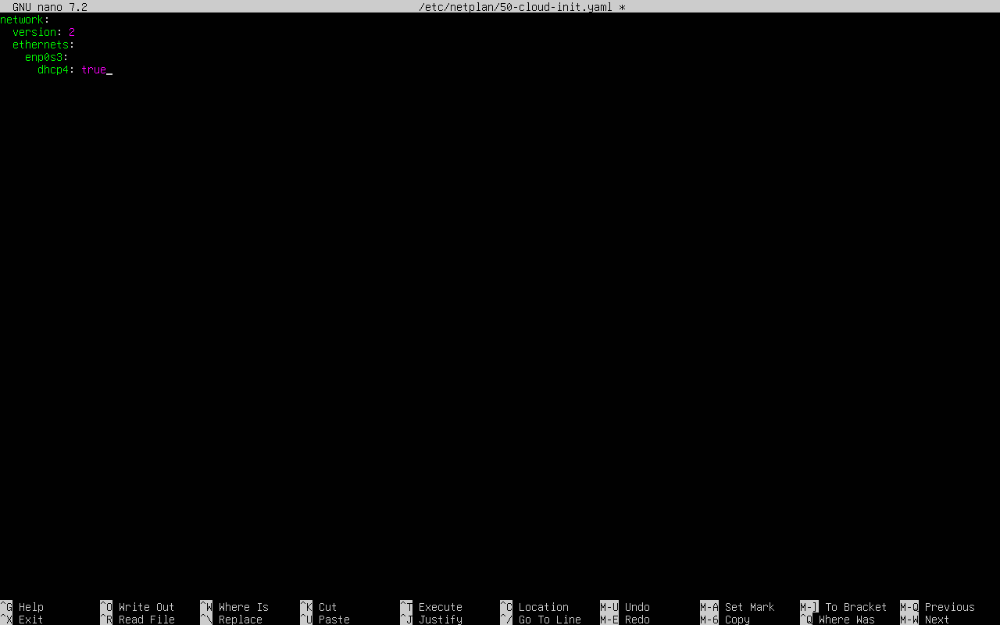
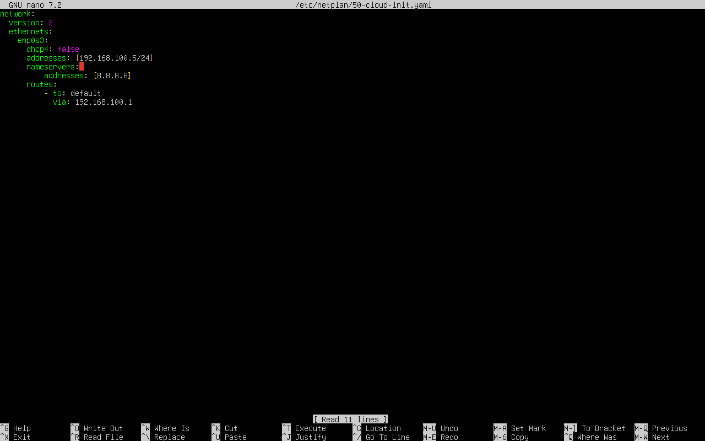

# Splunk static IP configurations

Before configuring the static IP, DHCP was enabled by default, allowing the server to obtain its IP address automatically from the network.

After configuration, DHCP was disabled and a static IP address (`192.168.100.5/24`) was assigned to the server.

Two additional network settings were configured:

- **Nameserver (`8.8.8.8`):** Specifies the DNS server used to resolve domain names into IP addresses.
- **Default route (`192.168.100.1`):** Specifies the gateway used to forward traffic to networks outside the local subnet.

**before**

**after**

